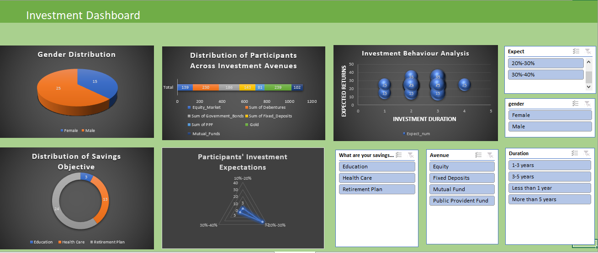

# Investment Analysis Dashboard | Microsoft Excel

## Project Overview
This project presents an interactive Investment Analysis Dashboard developed using Microsoft Excel. It explores investor demographics, investment preferences, savings objectives, and investment behaviour through charts and interactive filters.

## Project Objectives
- Analyze investor demographics.
- Explore different investment avenues.
- Understand savings objectives and financial preferences.
- Examine investment duration and expected returns.
- Present data through interactive visualizations.

## Tools Used
- Microsoft Excel
- Excel Charts
- PivotTables and PivotCharts
- Slicers and Interactive Filters

## Dashboard Features

### 1. Gender Distribution
Visualizes the distribution of participants by gender.

### 2. Investment Avenues
Shows participant distribution across different investment options.

### 3. Investment Behaviour Analysis
Explores the relationship between investment duration and expected returns.

### 4. Savings Objectives
Highlights participants' savings objectives, including healthcare and retirement planning.

### 5. Investment Expectations
Presents investment expectations through a chart.

### 6 Interactive Filters
Enables users to explore the available data using filters.

## Dashboard Preview

## Project Files
- `Investment dashboard.xlsx` — Excel workbook containing the dashboard.
- `Dashboard.png` — Dashboard preview image.

## Key Learnings
- Data visualization using Excel.
- Interactive dashboard development.
- Exploring investment preferences and demographics.
- Presenting data for easier interpretation.

## Future Improvements
- Add KPI cards and summary metrics.
- Expand investment analysis.
- Recreate the dashboard using Power BI.

## Author
**S K Sabataslim**

- [LinkedIn](https://www.linkedin.com/in/s-k-sabataslim)
- [GitHub](https://github.com/SK-SABATASLIM)
